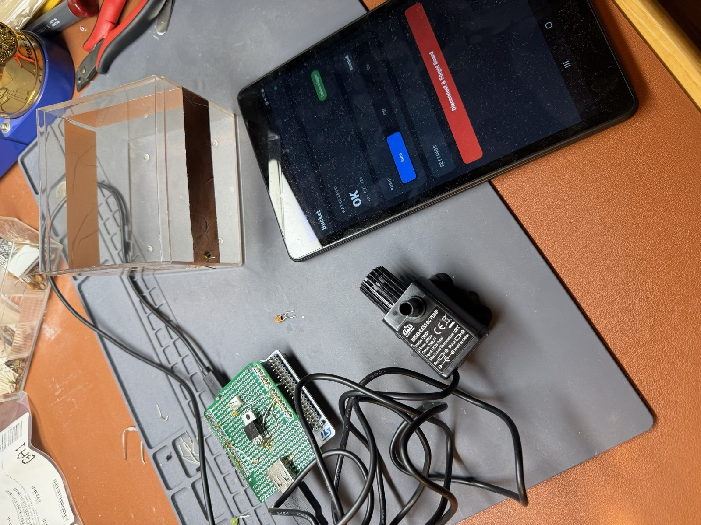

# bucket

Firmware for a **dehumidifier bucket auto-evacuator**.

A small STM32 BLE MCU watches the water level in a dehumidifier's collection
bucket with a **capacitive sensor** and, when the water reaches the trigger
level, runs an **evacuation pump** until the bucket is drained again.

The twist versus a classic float switch: there are no moving parts in the
sensor. We use the STM32 **TSC (Touch Sensing Controller)** with a capacitive
electrode taped to the outside of the bucket wall. Water rising past the
electrode changes the measured capacitance, which the firmware turns into a
level decision with hysteresis.



*Proof of concept on the bench. Clockwise from the top left: an acrylic test
tank with two copper-foil electrode bands, the Android client (water level
`OK`, raw TSC 326, pump in `Auto`), the 5 V brushless DC pump, and the
Nucleo-WB55RG with the home-made ARDUINO shield (sampling cap, electrode lead,
TIP31A pump driver, USB-A pump outlet).*

## Hardware

- **MCU board:** ST **Nucleo-WB55RG** (`nucleo_wb55rg`) — STM32WB55RG, Cortex-M4
  application core + Cortex-M0+ radio core, **Bluetooth LE**, and a hardware
  **TSC** peripheral. BLE is used to report level / pump state and for tuning.
- **Sensor:** copper-tape / PCB capacitive electrode on the bucket wall, driven
  by the TSC. (Experimental — see [`hard/`](hard/) and
  [`firm/README.md`](firm/README.md).)
- **Actuator:** low-voltage DC pump (POC: a 5 V brushless fish-tank pump),
  switched low-side by a TIP31A NPN. ARDUINO **D9** (PA9) drives its base
  through 330 Ω (`pump` alias in the devicetree overlay). Pinout and wiring
  are in [`hard/tsc-validation.md`](hard/tsc-validation.md).
- **Debug / flash:** on-board ST-LINK/V2-1 over USB.

## Repository layout

```
bucket/
├── README.md            this file
├── CLAUDE.md            guidance for Claude Code working in this repo
├── poc-system.jpg       photo of the proof-of-concept setup
├── firm/                Zephyr RTOS firmware (the application)
├── client/              React Native BLE client (Android-first)
├── hard/                hardware notes, electrode geometry, pump wiring
├── docs/                procedures (e.g. BLE coprocessor update)
├── test_e2e/            end-to-end tests (board + client)
└── openocd/             OpenOCD helpers for flashing/debugging the WB55
```

## Status

**Proof of concept works end to end** (2026-10-12):
- The TSC level sensing works on the bench and on the acrylic test tank.
- Hysteresis drives the real pump through the shield.
- The Android client pairs over encrypted BLE. It shows the level, the raw
  count and the pump state, and can switch the pump mode and tune the
  thresholds.

Shield validation: a 33 pF load on the sense electrode turns the pump on. See
[`hard/tsc-validation.md`](hard/tsc-validation.md).

**Remaining:** instrument the real dehumidifier tank. That means fitting the
electrode bands to its collection bucket, measuring dry and full counts, and
re-tuning the ON/OFF thresholds (`level set <off> <on>` or the app's Settings
form).

## Quick start

See [`firm/README.md`](firm/README.md) for toolchain setup, building, and
flashing. In short:

```sh
cd firm
source ./zephyr.env      # points at ~/zephyrproject + ~/venv + ~/zephyr-sdk
west build -b nucleo_wb55rg .
west flash               # or: openocd -f ../openocd/nucleo_wb55rg.cfg
```
